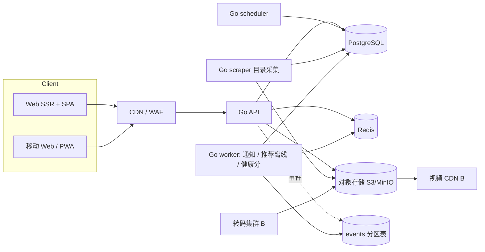

# REEL 设计稿产品评审与技术方案

版本：0.2 评审稿（按 PRD rev 25 与全部 70 个画板对齐）
日期：2026-10-15
输入：

- UI 设计稿「视频网站设计」（claude.ai artifact `RGKRixRrf5PqYiZDorq3jG`，70 个画板，含 T1 推荐架构、T2 播放架构）
- PRD：`docs/PRD.md`（REEL 视频站 PRD，rev 25）；数据侧另见 `docs/FINAL_DATA_DESIGN.md`（v1.1）、`docs/ROADMAP_STATUS.md`
- 逐画板对齐：`docs/DESIGN_ALIGNMENT.md`
- 当前代码：`main` 分支 `e4b7bd9`（Go API / scheduler / scraper，React 单文件 WebApp，迁移 001–006）

> v0.1 写作时没有拿到 PRD，以 `docs/REQUIREMENTS.md` 代替；v0.2 改为以 `docs/PRD.md` 为准，`REQUIREMENTS.md` 视为已被取代。

---

## 1 结论摘要

| # | 结论 | 严重度 |
|---|---|---|
| 1 | **产品定位冲突**：设计稿是一个自有片库的通用视频平台（自建转码、CDN、贴片广告、弹幕），仓库是 JAV 目录加第三方片源解析播放。两者在内容来源、版权、广告和合规上的前提完全不同，必须先定。 | 阻断 |
| 2 | **片源合法性**：`FINAL_DATA_DESIGN.md` 写明「不下载或分发受版权保护的视频」，但代码的 `/api/resolve` 解析第三方直链并在本站播放，设计稿 A2 还有「公开站点 403 被拦截自动换出口」和「拉取 → 转码 → 存储」。这三处互相矛盾。 | 阻断 |
| 3 | **定位与合规**：PRD 把 REEL 定为大众视频站（13+、青少年模式、屏蔽成人广告），仓库数据却是 JAV 目录。若按仓库数据做成人站，设计里的年龄确认、青少年模式和广告品类都不成立，还缺表演者年龄与同意记录、CSAM 防护、成人广告网络（第 2.2 节）。 | 阻断 |
| 4 | **PRD 与设计稿有 9 处不一致**：角色数、广告上线阶段、用户上传、会员标签、年龄确认等（`DESIGN_ALIGNMENT.md` 第 2 节）。`REQUIREMENTS.md` 已被 `PRD.md` 取代。 | 高 |
| 5 | **范围远超当前实现**：设计 70 个画板，当前前端是 61 行的单文件 React。按 PRD 的 Alpha → Beta → V1 → V1.1 分期（第 4 节）。 | 高 |
| 6 | **现有代码安全问题**：密码用无盐 SHA-256；会话令牌明文入库；前端 `onTimeUpdate` 每秒约 4 次写观看进度；管理员令牌会被带到所有请求上。上线前必须修。 | 高 |
| 7 | **设计与数据模型不对齐**：设计按「剧集 / 章节 / 配音 / 拍摄年份 / 类型（剧情、悬疑）」组织，数据是「品番作品 / 女演员 / 厂商 / JAV 标签 / 发售日」。需要一份字段映射，并决定哪些设计元素不做。 | 中 |

**建议**：先开一次决策会，定下定位（大众站或成人站）和第 2.1 节的片源模式，并处理 PRD 与设计稿的不一致，再按第 4 节分期开发。PRD 第 15 节已把「版权来源确认」设为第一道关卡，与本文结论一致。技术方案（第 3 节）按「方案 A：目录 + 授权嵌入/外链」写，并标出切换到「方案 B：授权自营托管」时需要增加的部分。

---

## 2 产品评审

### 2.1 定位与片源模式（需决策）

设计稿 M2「视频播放」和 T2 的前提是：平台持有视频文件，自己转码成 HLS 多码率，按片源分目录存储，走自家 CDN。仓库目前的实际做法是：

- 目录：从 JAV Database / XCITY / Jav.Guru 采集 metadata（`internal/catalog`）。
- 播放：前端下拉列出 19 个第三方站点，`internal/media` 下有 15 个站点适配器（含通用的 KVS 适配器），`POST /api/resolve/{source}/{id}` 解析出直链，前端用 `<video src>` 或 `<iframe>` 播放。

可选模式：

| 模式 | 做法 | 优点 | 风险 / 成本 |
|---|---|---|---|
| A 目录 + 授权嵌入/外链 | 只做 metadata、发现、推荐和用户功能；播放用权利方或 Affiliate 提供的官方嵌入播放器或预览，正片外链到购买/授权页 | 法律风险最低，和 `FINAL_DATA_DESIGN.md` 一致，不需要转码和 CDN | 播放体验受嵌入方限制；设计中的贴片广告、弹幕叠层、自动切源、章节截屏多数做不了或要降级 |
| B 授权自营托管 | 和制作方/发行方签授权，拿到母带后自己转码、存储、分发 | 能完整实现设计稿 | 需要授权合同、表演者年龄与同意记录、CSAM 扫描、存储和 CDN 成本（TB 级起步）、成人内容 CDN 选型 |
| C 现状：解析第三方直链 | 后端解析盗链站点的直链，前端直接播放 | 开发快 | 侵权；直链有时效、绑 IP、防盗链，稳定性差；反爬对抗（设计 A2 的「被拦截自动换出口」）成本持续上升；主流支付和广告网络都会拒绝接入 |

**评审意见**：不建议以模式 C 上线。建议首期按 A 实现，商务上同时推进 B 的授权；技术上把「片源」抽象成统一模型（第 3.3 节），使 A 和 B 可以共存，避免日后重写。现有 `internal/media` 第三方解析器建议降级为内部研究工具，不要暴露在公开 API 上。

### 2.2 成人内容合规

设计稿 C1–C5 已覆盖 Cookie 同意、版权投诉、法律页，方向是对的，但以下几处需要按成人站重做：

1. **年龄门槛**：C3 写的是「只在打开有年龄分级的视频时出现，不在进站时拦截」。成人站要做到首次进站即拦截，确认前不展示封面和标题。英国、美国多个州、欧盟部分国家要求第三方年龄验证（证件、信用卡或年龄估算），需要按访问地区接入验证服务，或者对相应地区禁止访问。
2. **青少年模式**：成人站不应提供「青少年模式」。C3、U3 中的青少年模式、家长密码、可用时段建议删除，改为「未满 18 岁禁止访问」。
3. **表演者年龄**：设计里「出演时年龄 = 拍摄年份 − 生日」。成人内容中任何计算结果小于 18 的组合必须自动下架并进入人工复核，不能只是标「约」后照常展示。拍摄年份在 JAV 数据源里基本没有，实际只有发售日。
4. **自营托管（模式 B）额外要求**：表演者身份与同意记录（如美国 18 U.S.C. §2257 的记录保存义务）、上传前做已知 CSAM 哈希比对、非自愿内容的快速下架通道。A2 的「用户投稿」来源在成人站还需要上传者实名和表演者同意证明；首期建议不开放投稿。
5. **广告**：AD1–AD4 的贴片、中插、激励广告设计基于主流广告网络（VAST/VMAP、IMA 一类）。成人站只能接成人广告网络或直客，素材规范、频控能力和 VAST 支持程度都不同，需要先选定网络再细化 AD4。
6. **个人信息**：A9 的演员信息更正与隐藏流程设计得好，建议同时覆盖「表演者要求删除作品页 / 照片」的下架流程，和 C4 版权投诉共用工单系统。

### 2.3 PRD 与设计稿的对齐

`docs/PRD.md` 覆盖了全部 70 个画板，每节都标了对应画板，埋点（第 14 节）、非功能需求（第 13 节）和里程碑（第 21 节）也都有。逐画板对照见 `docs/DESIGN_ALIGNMENT.md`，结论：

- 70 个画板都有 PRD 章节对应。
- PRD 与设计稿有 9 处不一致，需要 PM 和设计各自更新（对齐表第 2 节）。
- PRD 第 13、14、19 节的数值与本文 v0.1 不同，本文已按 PRD 改（对齐表第 4 节）。
- PRD 第 22 节还有 10 个待决问题未关闭，其中「片源授权」「首发市场」「广告平台」直接影响技术方案。

### 2.4 设计稿与数据模型的映射

| 设计稿概念 | 当前数据 | 处理建议 |
|---|---|---|
| 视频 / 作品 | `releases`（品番作品） | 1 作品 = 1 视频；JAV 极少分集，「系列 / S1E1 / 下一集」改用 `series` 和同系列作品排序 |
| 片源（正片 / 4K / 导演剪辑 / 配音） | `release_media_sources`（来源站点 + media_id） | 扩展成 `playback_sources`（3.3） |
| 演员（性别中性） | `performers`（女演员） | 文案和筛选按实际数据调整；男优数据当前不采集 |
| 拍摄年份 → 出演时年龄 | 只有发售日 `release_date` | 用发售日计算并始终标「约」；结合 2.2 第 3 点做小于 18 的拦截 |
| 类型（剧情、悬疑、纪录片） | `release_tags`（JAV 标签）、`makers` | 首页 chips 和 N4 分类改用标签分组 + 厂商 + 年份 |
| 章节、截屏、雪碧图预览 | 无 | 模式 A 下数据来源只有官方样图；章节截屏降级为「样图墙」 |
| 字幕 / 音轨 / 配音 | 无 | 模式 A 下不做；模式 B 再做 |
| 评分、短评、弹幕 | 无 | V1（评论 V1.1），按 3.8、3.13 节建表 |
| 播放次数、粉丝数、热度 | `*_source_metrics`（来源统计）+ 本站观看记录 | 前台只显示本站数据，或明确标注来源 |

### 2.5 设计稿内部问题与建议

- **评分（F5）**：PRD 第 19 节允许免登录按设备计票，用降权（未登录、注册不满 7 天）和人工确认来防刷。设备 ID 可以被清除重建，降权挡不住批量刷分；建议上线前按 PRD 待决问题加人机验证，并监控单视频的设备票占比。
- **自动切源（T2）**：首帧超过 8 秒或连续卡顿 3 次就切源，方向正确。模式 A 的 iframe 嵌入拿不到卡顿事件，只能对自托管和直链 HLS 生效。
- **进度共享**：「时长差超过 2% 单独记进度」很好，需要在数据上为每个片源存 `duration_seconds`，现在的 `watch_history` 只按作品记一条。
- **SEO**：A1 有「服务端渲染通过率」「站点地图覆盖」，I18n 要求 `/en/video/123` 和 hreflang，但当前前端是纯客户端 SPA。需要改成 SSR（3.1）。
- **推荐（T1、PRD 第 10 节）**：PRD 要求 V1 就用向量召回，P99 80 ms。冷启动期没有足够行为数据训练向量，建议 V1 用规则 + 协同过滤，向量在积累 3 个月埋点后上线（3.5）。跨语言向量搜索（PRD 第 4.5 节）同理。这一点需要 PM 确认。
- **弹幕**：自动翻译其他语言弹幕成本高、效果差，建议 V1.1 以后再做，首期只显示界面语言的弹幕。
- **电视端**：T2 提到「网页 · 手机 · 电视」，设计稿里没有电视端画板。建议明确首期不做。
- **设计稿的优点**：信息架构清晰；状态页（S2）、空状态和出错状态覆盖完整；后台把「入库流水线 / 去重 / 审计 / 搜索词补片」做成闭环，与仓库已有的 `identity_candidates`、`field_conflicts` 很契合；广告预算（每小时 ≤ 2 分钟）与频控规则写得具体，可以直接作为配置项。

### 2.6 现有代码的问题（与设计无关，上线前必须修）

| 位置 | 问题 | 修复 |
|---|---|---|
| `internal/store/auth.go:13` | 密码使用无盐 SHA-256，数据库泄露后可被彩虹表批量还原 | 改用 argon2id（`golang.org/x/crypto/argon2`）或 bcrypt；登录时对旧哈希做透明迁移 |
| `internal/store/auth.go:25` | 会话令牌明文存入 `user_sessions.token` | 存 `sha256(token)`，客户端只持有原值 |
| `internal/store/auth.go:18` | 注册时任何数据库错误都被报成「email already registered」 | 只对唯一约束冲突返回 409，其它返回 500 并记日志 |
| `web/src/main.tsx` `ReleasePlayback` | `onTimeUpdate` 每次触发都 POST 观看进度，播放时每秒约 4 次请求 | 节流到 10–15 秒一次，另在 `pause` / `ended` / `visibilitychange` 时上报 |
| `web/src/main.tsx` `api()` | 优先发送 `admin_token`，管理员登录后用户接口也带管理员令牌 | 管理接口和用户接口分开；改为 HttpOnly + SameSite cookie 会话，管理端独立域名或路径 |
| `web/src/main.tsx` | 用户令牌存 localStorage，任何 XSS 都能窃取 | 同上，改 cookie 会话并加 CSRF 防护 |
| `web/src/main.tsx` 媒体搜索区 | 第三方站点 iframe 没有 `sandbox`，`` 直接加载第三方封面 | 按 2.1 结论下线或加 `sandbox`、`referrerpolicy`，图片走本站对象存储 |

---

## 3 技术方案

以下按模式 A 设计；标 **[B]** 的部分只在选择授权自营托管时实施。

### 3.1 总体架构

保持现有「Go 服务 + PostgreSQL」的主体，按需增加组件，不在首期引入 Kafka、向量库等重型依赖。



| 层 | 选型 | 说明 |
|---|---|---|
| 前端 | Next.js（App Router）+ TypeScript；播放器 hls.js | 需要 SSR、语言前缀路由、hreflang、sitemap。当前 Vite SPA 只有 61 行，迁移成本低 |
| API | 现有 Go `net/http` 单体，按领域拆 package：`catalog`、`playback`、`account`、`social`、`ads`、`admin` | `cmd/api/main.go` 已有 36 个路由挤在一个文件里，先拆 handler 再加功能 |
| 数据库 | PostgreSQL 17（已有）；扩展 `pg_trgm`、`unaccent`；V1.1 加 `pgvector` | 事件表按月分区 |
| 缓存 / 限流 | Redis | 会话缓存、接口限流、弹幕和评分防刷计数、首页楼层缓存、广告频控 |
| 搜索 | V1 前用 PostgreSQL；量大后换 Meilisearch 或 OpenSearch | 见 3.4 |
| 异步任务 | 沿用现有 `jobs` 表 + 租约模型，新增 job 类型 | 通知发送、推荐离线计算、健康分汇总、翻译 |
| 对象存储 | S3 兼容（已有 `media_assets` 设计） | 封面、演员照片、样图；**[B]** 视频分片 |
| 部署 | 现有 Docker Compose + Ansible 单机；V1 前拆成 API 多实例 + 数据库主备（可用率 99.9%） | 先确认 `deploy/ansible/inventory.ini` 中的目标主机 |

### 3.2 数据模型增量

新增迁移按领域分文件（`007_*` 起），全部使用 `bigserial` 主键、`timestamptz`。

**播放**

```sql
CREATE TABLE playback_sources (
  id bigserial PRIMARY KEY,
  release_id bigint NOT NULL REFERENCES releases(id) ON DELETE CASCADE,
  kind text NOT NULL CHECK (kind IN ('official_embed','official_preview','external_link','hls_owned')),
  provider text NOT NULL,                 -- 授权方 / 合作方标识
  label text NOT NULL,                    -- 前台显示：正片 / 4K / 预览
  url text,                               -- embed 或外链地址；hls_owned 为空
  storage_prefix text,                    -- [B] 对象存储前缀
  max_height integer, has_hdr boolean NOT NULL DEFAULT false,
  duration_seconds integer,
  audio_langs text[] NOT NULL DEFAULT '{}', subtitle_langs text[] NOT NULL DEFAULT '{}',
  is_alt_version boolean NOT NULL DEFAULT false,   -- 时长差 >2%，不共享进度
  priority integer NOT NULL DEFAULT 100,
  region_allow text[], region_deny text[],
  license_ref text,                       -- 合同 / 授权编号，版权投诉时核对
  health_score real NOT NULL DEFAULT 1.0,
  status text NOT NULL DEFAULT 'active' CHECK (status IN ('active','degraded','disabled')),
  created_at timestamptz NOT NULL DEFAULT now(), updated_at timestamptz NOT NULL DEFAULT now()
);
CREATE INDEX ON playback_sources(release_id, status, priority);
```

`release_media_sources` 保留作为采集侧证据，审核通过的映射才写入 `playback_sources`。

`watch_history` 增加 `progress_key`：普通片源为 0，`is_alt_version` 的片源为该片源的 `id`；主键从 `(user_id, release_id)` 改为 `(user_id, release_id, progress_key)`，迁移时已有记录填 0。这样正片、高画质共享进度，其他版本单独记进度。

**用户与社交**

| 表 | 关键列 | 约束 |
|---|---|---|
| `user_settings` | user_id PK、ui_lang、content_lang、subtitle_langs[]、quality_pref、autoplay、history_paused、theme、notify_prefs jsonb、quiet_hours | 跨设备同步 |
| `user_identities` | user_id、provider（google/apple）、subject | `(provider, subject)` 唯一 |
| `follows` | user_id、performer_id、notify_mode（all/lead_only/off）| PK(user_id, performer_id) |
| `reservations` | user_id、release_id | PK，预约未上线作品 |
| `watch_later` | user_id、release_id、created_at | PK |
| `playlists` / `playlist_items` | 用户自建收藏夹 | 现有 `favorites` 视为默认收藏夹 |
| `ratings` | user_id、release_id、score smallint 1–10 | PK(user_id, release_id) |
| `reviews` | id、user_id、release_id、body ≤140、spoiler、watch_ratio、status | 进审核流 |
| `danmaku` | id、release_id、source_id、t_ms、body ≤50、color、mode、lang、user_id、status | 索引 `(release_id, t_ms)` |
| `reports` | id、target_type、target_id、reporter_id、reason、status | 举报统一入口 |
| `notifications` | id、user_id、kind、payload jsonb、merged_key、read_at、created_at | 站内通知 |
| `notification_outbox` | id、user_id、channel（push/email）、payload、send_after、status | 由 worker 发送 |

**内容与运营**

| 表 | 用途 |
|---|---|
| `translations` | `(entity_type, entity_id, field, lang)` 唯一；value、status（machine/draft/reviewed/stale）、source_hash（原文变化时标 stale） |
| `release_assets` | 样图、章节截屏、雪碧图 VTT，复用 `media_assets` |
| `chapters` | **[B]** release_id、start_ms、title |
| `home_slots` | 运营排期：slot、lang、region、date、release_id |
| `announcements` | 公告 |
| `search_queries` | 匿名化搜索日志：q_norm、lang、result_count、clicked_rank、created_at（按天分区） |
| `ad_campaigns` / `ad_creatives` / `ad_placements` / `ad_blocklist` | 广告（阶段待定，见第 4 节） |

**合规与后台**

| 表 | 用途 |
|---|---|
| `age_verifications` | user_id 或 device_id、method、verified_at、jurisdiction、provider_ref（不存证件原文） |
| `consent_records` | device_id / user_id、categories、gpc、version、created_at |
| `takedown_requests` | 版权、表演者隐私、非自愿内容三类工单；编号、状态、处理时限、关联对象 |
| `admin_roles` / `admin_user_roles` | A8 的 7 类角色（超级管理员、内容编辑、入库运维、审核员、运营、广告销售、外部译者） |
| `admin_audit_log` | 操作者、动作、对象、原因、前后差异；与现有 `review_events` 合并或互相引用 |
| `approvals` | 高风险操作双人审批 |

**事件**

```sql
CREATE TABLE events (
  id bigserial, occurred_at timestamptz NOT NULL, user_id bigint, device_id text,
  session_id text, name text NOT NULL, release_id bigint, source_id bigint,
  props jsonb NOT NULL DEFAULT '{}'
) PARTITION BY RANGE (occurred_at);
```

事件名和字段按 PRD 第 14 节：通用字段（`event_id` 去重、`play_id`、`consent`、`exp` 等）做成 `events` 的列，其余进 `props`；播放序列为 `play_request` → `first_frame` → `heartbeat`（每 10 秒）… → `play_end`。前端每 20 条或 30 秒批量上报，弱网存本地队列，页面关闭用 `navigator.sendBeacon` 发 `play_end`。服务端按 `event_id` 去重，字段不合格的进隔离表。未同意分析 Cookie 的用户只发不含 `user_id` / `device_id` 的匿名计数。原始事件保留 90 天。

### 3.3 播放服务

接口：`GET /api/releases/{slug}/play-config?lang=&region=`，一次返回：

```json
{
  "release": {"slug": "juq-743", "title": "…", "duration_seconds": 7200},
  "sources": [
    {"id": 12, "kind": "official_embed", "label": "官方预览", "url": "…", "priority": 1,
     "max_height": 1080, "is_alt_version": false}
  ],
  "resume": {"source_id": 12, "position_seconds": 1834},
  "ads": null,
  "danmaku": {"enabled": false},
  "subtitles": [],
  "chapters": []
}
```

选源规则（服务端排序，前端按顺序尝试）：

1. 过滤：`status = active`、地区允许、对当前用户可见（年龄验证已通过）。
2. 排序：用户画质偏好匹配 → `health_score` → `priority`。
3. 前端在首帧超过 8 秒或 60 秒内卡顿 3 次时切到下一个源，只有非 `is_alt_version` 的源之间才带进度跳转；切换后提示「已切换到片源 2」并上报 `source_switch` 事件。

健康分：worker 每 10 分钟用最近 24 小时的 `first_frame`、`stall`、`play_error` 事件计算

```
health = 0.7 × 可播放率 + 0.3 × 首帧 ≤ 3s 的比例
```

低于 0.8 置为 `degraded` 并在 A1 后台告警，低于 0.5 自动 `disabled`。权重先按设计稿的「0.7 / 0.3」实现，上线后调。

**[B] 自营转码**：对象存储收到母带后创建 `transcode` job → FFmpeg 产出 HLS（CMAF fMP4，240p–1080p，4K 按需）、24 张截图、雪碧图 + WebVTT → 写 `playback_sources(kind='hls_owned')`。分片走签名 URL（短时效 token），CDN 按分片缓存。上线前对每个文件做 CSAM 哈希比对和人工抽检。

**系统媒体控制与投屏（已实现，web 端）**：

- Media Session（`web/app/lib/useMediaSession.ts`）：播放中的 `<video>` 向锁屏 / 耳机 / 蓝牙遥控 / 键盘媒体键 / 系统媒体面板提供标题、主演、厂牌或系列、封面（绝对 URL，带尺寸），支持播放、暂停、停止、±10 秒（遵循 `seekOffset`）、拖动（`fastSeek`）；上一个 / 下一个按 `?list=` 队列 → 系列选集 → 自动连播的下一部，没有目标时不注册。迷你播放器沿用同一个 `<video>`，会话不断。
- Remote Playback（`web/app/lib/useRemotePlayback.ts`）：浏览器报告有可用设备时，控制栏和全屏触控层出现「投屏」按钮（Chrome / Android 投放菜单、Safari AirPlay，Safari 旧接口 `webkitShowPlaybackTargetPicker` 兜底），连接中 / 已连接显示在按钮和「正在投屏到设备」浮层上，进度条保持可见。
- hls.js 播放的 HLS 是 MediaSource（blob: URL），接收端拿不到，因此这类片源设 `disableRemotePlayback` 并隐藏按钮；直链 MP4 和浏览器原生播放的 HLS（Safari、Android Chrome、较新的桌面 Chrome）可以投屏。
- 已知限制：投屏设备自己去拉流，不带本站的 Referer、Cookie 和会话。依赖 Referer 防盗链、Cookie 鉴权或绑定观看者 IP / 会话的签名 URL 的片源，在设备上可能播放失败，而本机播放正常。[B] 自营转码的签名 URL 如要支持投屏，签名不能绑定观看者 IP，且有效期要覆盖整场播放（或改为按分片续签）。
- 后续：Google Cast SDK（自定义接收端、由发送端刷新签名）不在本期范围，按需求再评估。

### 3.4 搜索

**Alpha（PostgreSQL）**

- 品番精确匹配：规范化查询词（`juq743` → `juq-743`），命中直接跳详情。
- 标题与别名：`pg_trgm` GIN 索引覆盖 `releases.canonical_title`、`title_ja`、`performer_aliases.alias`、`translations.value`；按相似度排序。
- 联想：前缀 + 热门搜索词，Redis 缓存 5 分钟。
- 结果页混排：演员卡（命中别名时）在前，作品列表在后，和设计稿 04 一致。
- 每次搜索写 `search_queries`，A6「无结果搜索词」直接查这张表。去修饰词二次搜索（「全集 / 在线看 / 高清 / 中字」）在服务端做：首次零结果时去掉词表中的修饰词再查一次，并记录 `rescued = true`。

**数据量增长后**：数据过 50 万条或需要多语言分词、拼写纠错时，切到 Meilisearch（运维简单）或 OpenSearch（日文用 kuromoji、中文用 IK/smartcn）。由 worker 增量同步，PostgreSQL 仍是事实源。

**V1.1**：语义和跨语言向量搜索（文本 embedding 召回），依赖 3.5 的向量基础设施。

### 3.5 推荐

按数据积累分三期，接口从一开始就按最终形态定义：`GET /api/recs?slot=home|related|similar_performers|tonight&context=…`，每条返回 `reason`（「因为你看过《…》」）。

| 期 | 召回 | 排序 | 依赖 |
|---|---|---|---|
| Alpha 规则 | 热门（7 天播放）、新上线、同演员、同系列、同标签、同厂商 | 规则加权 + 已看过滤 + 演员去重 | 现有表 |
| V1 协同 | 物品协同过滤：worker 每天从 `watch_history` 计算共现，写 `release_similar(release_id, similar_id, score)`；演员相似度 = 标签/厂商相似 + 共演 + 观众共现，按 A9 可调权重合并，写 `performer_similar` | 线性模型（点击率 × 完播率） | 每天活跃用户数千以上 |
| V1.1 向量 | item2vec / 双塔模型产出用户、作品、演员向量，`pgvector` HNSW 近邻 | GBDT 精排；重排做多样性、可播过滤 | 埋点稳定 3 个月以上；需要时再引入专门的向量库 |

冷启动沿用设计：新用户用引导里选的标签和演员；访客用热门 + 新上线；新演员借用标签与厂商相近的老演员。「今晚看什么」（F3，V1）先用规则：时长筛选 + 未看过 + 关注演员或高分，换一部时排除已展示的。

性能目标：规则和协同两期全部预计算，接口只做查表和过滤，P99 < 50 ms；首页楼层按用户缓存 10 分钟。

### 3.6 账号与安全

- 密码：argon2id，登录时把旧 SHA-256 哈希透明升级；失败次数按 IP 和账号限流。
- 会话：服务端会话，cookie `HttpOnly; Secure; SameSite=Lax`，库里存令牌哈希；写请求校验 CSRF token。保留 Bearer 方式供移动端。
- 第三方登录：Google、Apple（OIDC），写 `user_identities`；邮箱验证、找回密码走一次性令牌（存哈希，30 分钟过期）。
- 删除账号：标记删除，30 天后由 worker 硬删除用户数据（设计稿 U3）。
- 后台：独立的管理员账号体系，强制 TOTP 两步验证；RBAC 按 A8 的角色；所有写操作记 `admin_audit_log`；查看用户观看记录要单独权限并记日志；删除视频、批量下架、导出用户数据走双人审批。现有 `ADMIN_TOKEN` 只保留给运维脚本。

### 3.7 通知

- 触发：作品状态变为已上线、预约作品的前一天，由 scheduler 创建 `notify_fanout` job。
- 扇出：按 `follows`（主演 / 全部）和 `reservations` 找用户 → 写 `notifications`，同一作品只提醒一次，同一天多部合并成「你关注的 N 位演员有新作」（`merged_key = user_id + date`）。
- 投递：站内即时可见；Web Push（VAPID）和邮件写 `notification_outbox`，免打扰时段内的顺延到 `send_after`。
- 发送服务首期用一个 SMTP 服务商，失败按现有 job 重试策略重试。

### 3.8 互动：评分、短评、弹幕、举报

- 评分按 PRD 第 19 节：1–5 星，换算 10 分制；贝叶斯平均，未登录、注册不满 7 天、异常账号降权；少于 50 人显示「评分人数不足」。`ratings` 的键改为 `(release_id, voter_key)`，`voter_key` 是用户 ID 或设备 ID。剧集每集单独评分。
- 短评和弹幕写入前同步检查：用户限流（新账号前 3 天每分钟最多 3 条）、关键词词表；命中的设为 `shadow`（仅本人可见）进入 A7 审核队列。剧透、广告引流分类模型放到 V1.1；PRD 第 5.5 节的处理动作（折叠为剧透、删除并禁言、删除、放行）在 V1 就做。
- 弹幕读取：按 60 秒一段分片，`GET /api/releases/{slug}/danmaku?source=&from=&to=`，CDN 缓存 30 秒。实时推送（WebSocket）放到 V1.1；V1 只做录播式弹幕，体验差异不大。
- 弹幕波峰按 PRD 第 5.5.1 节：每视频 200 桶，发送时在 Redis 按「视频 + 版本 + 桶」累加；新视频每 1 分钟、其余每 10 分钟重算（去重 → 3 桶平滑 → 归一化 0–255），写成静态文件走 CDN，随 `play-config` 返回；有效弹幕少于 50 条不返回。
- 刷分识别：同一时段内大量同分、新号集中评分，进 A7 由人工确认剔除。

### 3.9 广告（阶段见第 4 节；成人站定位时依赖 2.2 第 5 点）

- 播放器侧实现 VAST 4 / VMAP 解析（或使用所选成人广告网络的 SDK），贴片、暂停、中插位置由 `play-config.ads` 下发。
- 频控在服务端用 Redis 计数：用户（或设备）每小时 ≤ 90 秒，单视频暂停广告 ≤ 3 次，首日和前 3 次播放不出贴片和中插（AD4）。所有阈值做成 `ad_placements` 配置。
- 未同意个性化广告 Cookie 或检测到 GPC 时只投上下文广告。
- 广告事件（曝光、可见、完成、跳过、关闭页面）走同一条事件管道，A1 和 AD3 的报表从事件聚合。

### 3.10 多语种

- 三层分开：界面语言（前端 i18n 资源文件）、内容语言（`translations` 表）、字幕 / 音轨（**[B]**）。
- 路由：`/{lang}/releases/{slug}`、`/{lang}/performers/{slug}`；SSR 输出 hreflang 和分语言 sitemap。首次访问按 `Accept-Language` 选语言，登录后以 `user_settings` 为准。
- 回退链：zh-TW → zh-CN → en → 原文（日文），全部在 API 层完成，前端不出现空白字段。
- 翻译流程（A10）：机器翻译生成 `status = machine` → 译者改成 `draft` → 审校后 `reviewed` 才对外。原文变化时 `source_hash` 不一致，自动标 `stale`，前台继续显示旧译文。机器翻译的提供方另行选型。

### 3.11 后台

在现有审核页的基础上按设计稿扩展，前端放在同一个 Next.js 应用的 `/admin` 路由下，单独打包、单独会话。

| 画板 | 后端能力 | 现状 |
|---|---|---|
| A1 总览 | 聚合事件、任务、审核队列的统计接口 | 无 |
| A2 入库流水线 | 现有 `sources` / `jobs` / `crawl_checkpoints` + 新的阶段视图 | 采集侧已有，片源侧无 |
| A3 作品编辑 | 作品字段、`playback_sources`、演员关系、翻译、上下线和定时上线 | 只有 `media-link` 接口 |
| A4 去重归并 | `identity_candidates`、合并 / 拆分 / 撤销 | 候选查询已有，合并未做 |
| A5 数据质量 | 夜间审计 job：缺字段、小于 18 岁、编码、可播放率 | 无 |
| A6 搜索词 | `search_queries` 聚合 | 无 |
| A7 运营与审核 | `home_slots`、`announcements`、`reports`、短评与弹幕审核 | 无 |
| A8 用户与权限 | 用户检索、处罚、RBAC、审批 | 无 |
| A9 演员 | 演员编辑、相似权重、隐私更正工单 | 无 |
| A10 翻译 | `translations` 工作台 | 无 |
| AD3 广告 | 广告位、投放、素材审核、品类屏蔽 | 无 |

### 3.12 可观测性与非功能指标

- 日志：结构化 JSON（`log/slog`），带 request_id、user_id 哈希、job_id；不记录令牌、密码、IP 原文。
- 指标：Prometheus 格式 `/metrics`；关键指标为 API 延迟分位数、5xx 比率、任务积压、过期租约数、片源健康分、首帧 P75。
- 告警沿用 `PRODUCTION_OPERATIONS.md` 中的规则，另加「可播放率 < 95%」和「年龄验证服务不可用」。

| 指标 | 目标（草案，PRD v1 确认） |
|---|---|
| 首页 / 视频页 / 演员页 LCP（P75，手机） | ≤ 2.5 s；CLS ≤ 0.1 |
| 作品详情 API P99 | ≤ 150 ms |
| 推荐 API P99 | ≤ 50 ms（预计算） |
| 播放首帧 P75（4G） | ≤ 1.5 s（PRD 第 13 节；只对自营 HLS 可控，嵌入源只监测） |
| 前台可用率 | 99.9%（PRD 第 13 节；单机达不到，Beta 前要 API 双实例 + 数据库主备） |

### 3.13 补充能力（逐画板对齐时发现缺失）

**前台用户功能**

| 能力 | 画板 / PRD | 数据与接口 |
|---|---|---|
| 赞 / 踩、分享 | `Video` / 5.4 | `release_reactions(user_id, release_id, value ±1)`；分享用规范 URL + Open Graph 标签（SSR 输出） |
| 评论与回复 | `Video` / 5.4（V1.1） | `comments(id, release_id, parent_id, user_id, body, likes, status)`；与短评共用审核流；回复触发通知 |
| 自动连播 | `Video` `Settings` / 5.4 | `GET /api/releases/{slug}/next`：同系列下一集优先，否则取相关推荐第 1 条；倒计时 10 秒在前端 |
| 即将上线与预约 | `NavNew` `NewWorkAlert` / 4.3、17 | `releases.status` 增加 `upcoming`，加 `scheduled_at`；到点由 scheduler 改为 `published` 并触发通知 |
| 热门榜 | `NavTrending` / 4.2 | 每小时任务按播放量、完播率、增长速度算分，写 `trending_snapshots(period, rank, release_id, score, prev_rank)`；演员热度榜同理 |
| 热搜与最近搜索 | `MobileSearchTyping` / 4.5 | 热搜：`search_queries` 每小时聚合 Top 20；最近搜索：`user_search_history`（登录）或 localStorage（访客），可清除 |
| 观看记录管理 | `NavHistory` / 7 | 单条删除、清除全部、暂停记录（`user_settings.history_paused`，暂停期间不写 `watch_history`、不进推荐） |
| 稍后观看 | `NavLater` / 7 | `watch_later.position` 支持拖动排序；看完 90% 自动移出（开关在设置） |
| 收藏夹 | `NavFavorites` / 7 | `playlists.visibility`（private / public / link），`share_token` 用于链接可见 |
| 关注动态流 | `MobileFollowing` / 7 | `GET /api/me/following/feed`：关注演员的新上线和即将上线作品，按时间倒序；`follows.last_seen_at` 算侧栏红点 |
| 收藏更新通知 | `Notifications` / 7 | 片源或字幕新增时，对收藏该作品的用户写通知（第 4 类） |
| 演员统计与作品筛选 | `Actor` `NavActors` / 6.1、6.2 | 夜间汇总 `performer_stats`（作品数、总播放、粉丝、30 天热度排名）；`release_performers.role_type`（lead / guest）用于主演 / 客串筛选和「只提醒主演」 |
| 外观主题 | `TopBar` `*Light` / 8 | 设计令牌深浅两套 CSS 变量；`user_settings.theme`，未登录存 cookie 以便 SSR 首屏不闪 |
| 迷你播放器、画中画、手势、快捷键 | `MobileHome` `MobilePlayerFull` / 5.1、9 | 前端：播放器挂在应用根节点，路由切换不卸载；快捷键按 PRD 第 5.1 节 |
| 片头标注与跳过 | `Settings` / 14.3 | `releases.intro_end_ms`，运营手填或由跳过区间提示（3.14）；`play-config` 返回 |
| 记住倍速、省流量 | `Settings` / 9 | `user_settings.remember_rate`、`data_saver`；倍速按视频存在客户端 |
| 新手引导 | `Onboarding` / 20 | `user_interests(user_id, tag_id / performer_id)`，进推荐冷启动 |
| 观看统计 | `WatchStats` / 20 | 夜间从 `watch_history` 和 `heartbeat` 汇总 `user_watch_daily(user_id, date, seconds, by_hour[24], by_tag)`；清除记录时一并删除 |
| 设备管理 | `Settings` / 20 | `user_sessions` 增加 `device_name`、`last_seen_at`、`ip_hash`；可逐台退出 |
| 数据导出与注销 | `Settings` `LegalPage` / 15 | 导出：后台任务打包 JSON，邮件发下载链接（24 小时有效）；注销：30 天冷静期后硬删除 |
| 法律文本版本 | `LegalPage` `Account` / 15 | `legal_documents(kind, lang, version, effective_at, body)`；`terms_acceptances` 记录用户同意的版本 |
| 帮助、反馈、片源报错 | `LegalPage` `States` / 12 | `feedback(kind, release_id, source_id, body)`，片源报错计入健康分 |
| 青少年模式 | `AgeGate` `Settings` / 15 | 仅在大众站定位下做：`user_settings.teen_mode`、独立密码哈希、按账号计时（Redis 当日累计秒数）；内容按 `releases.age_rating` 过滤 |

**后台与平台能力**

| 能力 | 画板 / PRD | 数据与接口 |
|---|---|---|
| 夜间任务页 | `AdminDashboard` `AdminNav` / 11 | `nightly_runs(job, started_at, duration, checked, fixed, result)`；现有 jobs 表的任务结束时写入 |
| 「不是重复」记忆 | `AdminDedupe` / 11 | `not_duplicate_pairs(entity_type, a_id, b_id)`，去重扫描跳过；演员合并后旧 slug 写 `slug_redirects` 做 301 |
| 搜索同义词与跳转 | `AdminSearch` / 4.5 | `search_synonyms(term, canonical)`、`search_redirects(term, target_url)`，查询前展开 |
| 相似演员权重 | `AdminActors` | `similarity_weights` 一行四个权重；保存后预览 20 位演员结果，次日夜间任务生效 |
| 即将上线作品 | `AdminActors` / 17 | 即为 `releases.status='upcoming'`；日期未定（`scheduled_at` 为空）只在演员页显示，不推送 |
| 术语表与界面文字 | `AdminI18n` / 8 | `glossary_terms(term, lang, translation)` 供机翻和译者参考；界面文字 `ui_strings(key, lang, value, status)`，构建时导出成前端资源文件 |
| 实验框架 | `Main` S5、`AdDepth` / 14.1、16.6 | `experiments(key, variants, traffic, guardrails)`；按 `user_id` 或 `device_id` 哈希分组，分组写进事件的 `exp`；护栏指标（人均时长、完播率、次日留存）任一下降超过 2% 自动停止 |
| 账号状态 | `AdminUsers` | `users.status`：active / unverified / muted（带到期时间）/ deleting / banned；`admin_audit_log` 加来源 IP；登录失败 5 次锁定 |

### 3.14 播放波峰与留存曲线（PRD 第 14.3 节）

- 客户端：每次播放在内存记 200 格计数表，桶播放满 50% 加 1；只算倍速 ≤ 2×、前台或画中画、非广告时段。随 `play_end` 上报，长视频每 5 分钟随 `heartbeat` 报增量。
- 服务端：worker 每小时按作品时间轴（「其他版本」单独）汇总 `viewers[b]`、`replays[b]`、`skips[b]`，存 `release_curves(release_id, version_key, kind, data smallint[200], computed_at)`。
- 前台波峰 = 重看率，去掉开头 3% 和结尾 5%，3 桶平滑，归一化 0–255；有效播放少于 1000 次不出曲线。弹幕开启时与弹幕波峰按 70% / 30% 混合，前台只显示一条。
- 防刷：同一用户或设备对同一视频每天最多计 3 次；无交互连续播放超过 2 小时的设备不计。
- 用途：`AdminVideo` 数据标签（留存、重看、跳过曲线）；中插避开重看前 3 高峰前后 60 秒；跳过集中在开头时提示运营标注片头。

---

## 4 分期计划

按 PRD 第 21 节的阶段和关卡排期；估时按 2 人后端 + 1 人前端，关卡未过不进入下一阶段。

| 阶段 | 工程内容 | 主要画板 | 估时 | 出口关卡（PRD） |
|---|---|---|---|---|
| 设计定稿 | 修复 2.6 全部安全问题；拆分 API handler；Next.js 骨架与设计令牌；`play-config` 接口雏形 | 组件 | 2 周 | 关卡 1：版权来源确认，拿到授权清单 |
| 内测 Alpha | 发现（首页、热门、新上线、分类）、搜索、播放页与多片源、演员页与演员库、手机 4 Tab 与迷你播放器、状态页；后台总览、入库流水线、视频编辑、重复归并、数据质量、演员管理；埋点管道 | N1–N4、04、02、03、N5、M1–M8、M11、S2、A1–A5、A9、T2 | 7 周 | 关卡 2：片源健康分 ≥ 95，收录健康分 ≥ 90 |
| 公测 Beta | 注册登录（含 Google / Apple）、记录 / 稍后看 / 收藏夹、关注与动态、新作提醒与预约、通知、新手引导、设置、多语种（URL 前缀、翻译表、翻译工作台）、浅色外观、Cookie 同意、年龄确认、法律页 | 05、N6–N8、M9–M10、S1、F1–F2、U1–U4、06、A10、L1–L3、C1–C3、C5 | 6 周 | 关卡 3：律师审阅完成，版权投诉流程演练一次 |
| V1 正式上线 | 个性化推荐（规则 + 协同过滤）、今晚看什么、评分与短评、弹幕与弹幕波峰、首页运营排期与公告、举报与版权投诉、后台角色权限与审计、搜索词情报；多实例部署 | F3–F6、DM1–DM2、A6–A8、C4、T1 | 6 周 | — |
| V1.1 | 评论、观看统计、播放波峰与留存曲线、向量召回与跨语言向量搜索、实验框架；广告（如 PRD 待决问题定为 V1.1） | U5、AD1–AD4 | 6 周以上 | — |

PRD 第 16 节把广告写在本期，第 21 节写在 V1.1，需要 PM 定一个（`DESIGN_ALIGNMENT.md` 第 2 节 #5）。不做：电视端（设计稿无画板）。按成人站定位时另去掉青少年模式，并把进站 18+ 验证提到 Beta 之前。

---

## 5 待决策事项

1. 定位：按 PRD 做大众视频站，还是按仓库数据做成人站（`DESIGN_ALIGNMENT.md` 第 1 节）。
2. 片源模式 A / B / C（第 2.1 节；PRD 待决问题「片源来源」）。
3. PRD 与设计稿的 9 处不一致由谁更新（对齐表第 2 节）。
4. V1 是否必须上向量召回和跨语言向量搜索（第 2.5 节）。
5. 广告在本期还是 V1.1；广告平台选型（PRD 待决问题）。
6. 首发市场与语言，是否面向中国大陆（PRD 待决问题，影响部署位置和备案）。
7. 免登录评分是否加人机验证（PRD 待决问题）。
8. 推送通道和邮件服务商（PRD 待决问题，影响 Beta 的新作提醒）。
