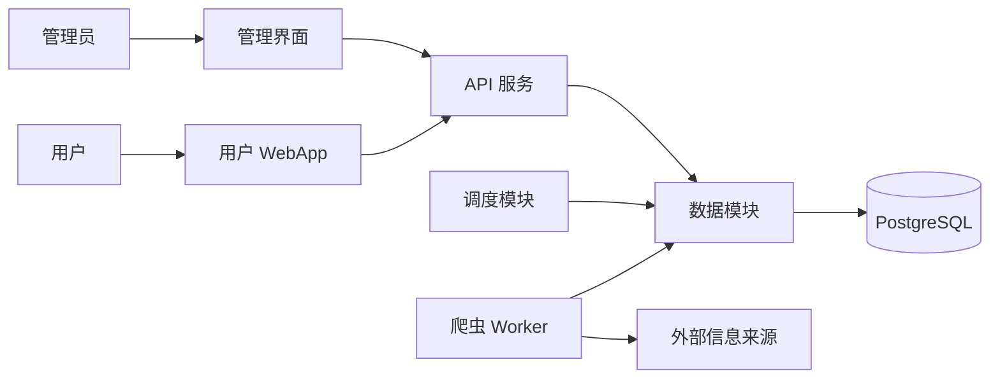

# avxxx 信息采集与展示平台需求文档

版本：0.1 草案  
日期：2026年10月7日  
适用范围：avxxx 项目的产品设计、模块开发与验收

## 1 项目目标

参考 books 的模块结构，建立信息采集、数据管理、用户展示相互协作的平台。管理员配置来源并管理采集任务，爬虫持续更新信息，数据模块统一保存和治理数据，用户通过 WebApp 浏览、搜索和收藏内容。

业务信息类型、目标网站及采集字段尚待确定。本版以通用信息条目定义需求，RSS/Atom 为首个采集来源；网站页面采集通过独立适配器扩展。

## 2 books 架构参考与模块对应

books 采用两个 Go 程序和一个 React SPA 共享 PostgreSQL 的结构。API 和爬虫统一通过 store 访问数据库，迁移随服务启动执行。avxxx 沿用这一结构，补充来源、采集任务和数据治理能力。

| books 模块 | avxxx 模块 | 职责 |
|---|---|---|
| cmd/scraper、internal/scraper | 爬虫服务 | 来源采集、解析、标准化、任务执行 |
| cmd/api、internal/api | API 服务 | 用户查询、身份验证、管理操作 |
| web | 用户 WebApp 与管理界面 | 展示内容、用户操作、数据和采集管理 |
| internal/model、internal/store | 数据模块 | 数据模型、数据库访问、去重、任务状态及事务 |
| migrations | 数据迁移模块 | 数据库版本管理与升级 |
| internal/sanitize | 内容处理模块 | 清洗内容、过滤危险 HTML、校验链接 |
| mailer、notify、digest 等 | 可选通知模块 | 收藏更新通知、邮件摘要 |
| egress | 可选网络出口模块 | 集中管理代理和采集出口 |
| deploy | 部署运维模块 | 服务部署、日志、监控、备份恢复 |

邮件、通知、出口代理等按实际业务需要接入，不属于首版必需功能。

爬虫与 API 通过共享的数据模型、任务表和数据库协作，不要求彼此直接调用。网页端不得直接访问数据库；数据库访问统一封装在数据模块。

## 3 用户角色

| 角色 | 权限 |
|---|---|
| 访客 | 浏览已发布信息、搜索、查看详情及来源 |
| 注册用户 | 访客权限，以及收藏、订阅和个人设置，安排在后续阶段 |
| 管理员 | 来源管理、任务操作、内容审核编辑、运行统计和审计查询 |
| 系统 Worker | 按任务执行采集和保存结果，不提供用户管理权限 |

生产环境的管理界面和接口必须鉴权。当前 ADMIN_TOKEN 仅作为开发阶段入口，后续采用管理员账号与会话机制。

## 4 爬虫模块需求

### 4.1 来源与适配器

- 支持 RSS/Atom；按业务确认后的清单增加网站适配器。
- 每个来源具有名称、入口 URL、适配器类型、启用状态和采集策略。
- 网络请求与页面解析分离。适配器负责解析为统一条目，抓取器负责超时、响应大小、限速、重试和网络出口。
- 不支持的来源或解析失败必须返回可定位的错误，不得作为成功任务处理。
- 提供试采集能力，展示解析结果及去重判断，不写入正式内容。

### 4.2 采集执行

- 支持手动采集和按来源配置的定时采集。
- 同一来源默认只允许一个待执行或执行中任务，避免重复调度。
- 支持多 Worker 并发，任务领取必须具有原子性。
- 请求须配置超时和响应大小限制；按站点限制请求频率。
- 对超时、连接错误、429 和可重试的服务端错误执行有上限的退避重试，遵循 Retry-After。
- 对解析规则失效及不可重试错误记录失败原因，供管理员处理。
- 采集只更新变化的条目，并保留来源和最近成功采集时间。

### 4.3 任务可靠性

任务状态为 pending、running、succeeded、failed；取消状态在支持取消功能时增加。任务记录来源、尝试次数、领取时间、完成时间、心跳、错误类型及新增更新数量。

Worker 领取任务后定期更新租约。租约过期的任务应按重试策略回收；重新领取须使用执行版本或持有者校验，防止旧 Worker 覆盖新结果。失败重试超过上限后进入 failed，管理员可创建新的执行任务。

## 5 用户 WebApp 需求

### 5.1 信息浏览

- 首页提供最近更新列表，展示标题、摘要、来源和更新时间。
- 支持分页、来源筛选、分类或标签筛选，以及排序。
- 条目详情展示完整可展示字段与原始来源链接。
- 已下架或未审核内容不得出现在公开列表和详情中。
- 无数据、加载中、服务失败和无搜索结果均提供明确状态。

### 5.2 搜索与个人功能

首版按标题搜索；后续增加摘要和正文全文搜索。注册用户后续可收藏条目、查看收藏列表、订阅来源或分类。收藏与订阅数据按用户隔离，重复收藏应保持幂等。

### 5.3 展示安全与体验

支持桌面和移动设备。摘要默认按文本展示；如需展示富文本，必须先清洗，禁止脚本、危险链接及事件属性。外链须校验协议。页面应支持键盘操作，表单错误及异步状态应可感知。

## 6 数据模块需求

数据模块同时服务爬虫和 WebApp，是内容及采集管理的统一入口。它负责数据一致性和生命周期，调度决策由调度模块负责，网络抓取由爬虫负责。

### 6.1 数据管理能力

- 统一条目模型、来源模型及任务模型，提供稳定的读写接口。
- 基于来源标识和来源条目 ID 或规范化 URL 去重；跨来源合并作为独立后续能力。
- 校验必需字段，记录来源、采集时间、内容更新时间和处理状态。
- 原子保存一次任务的内容结果和任务完成状态；失败时不得留下部分完成的成功记录。
- 支持内容编辑、发布、下架及软删除，保留审计记录。
- 人工编辑字段与采集字段需明确覆盖策略，避免下一轮采集覆盖人工修正。
- 数据库结构采用版本化迁移；API 与 Worker 同时启动不得重复执行同一迁移。

### 6.2 管理界面

- 来源管理：添加、编辑、启用、禁用、试采集，查看最近成功时间和错误。
- 任务管理：按来源和状态筛选，查看进度及错误，创建任务、重试失败任务。
- 内容管理：搜索和筛选条目，查看详情，编辑分类标签，审核发布与下架。
- 数据概览：来源数量、条目数量、待执行和失败任务、最近采集结果。
- 禁用来源后不得新增调度任务；已有待执行和执行中任务的处理策略须明确。

## 7 数据模型

| 实体 | 关键字段 | 约束 |
|---|---|---|
| 来源 Source | ID、名称、URL、适配器、启用状态、采集间隔、最近成功时间 | 来源入口唯一，策略字段可校验 |
| 内容 Item | ID、来源 ID、来源条目 ID、标题、URL、摘要、正文、发布时间、更新时间、状态 | 去重键唯一，公开查询仅返回已发布数据 |
| 任务 Job | ID、来源 ID、状态、尝试次数、租约、执行版本、起止时间、错误、结果计数 | 原子领取，同一来源最多一个活跃任务 |
| 分类和标签 | ID、名称、条目关联 | 名称规范化，关联不可重复 |
| 用户 User | ID、登录标识、角色、账号状态 | 登录标识唯一，凭据安全存储 |
| 收藏 Favorite | 用户 ID、条目 ID、创建时间 | 用户和条目组合唯一 |
| 审计 AuditEvent | 操作者、动作、对象、时间、变更摘要 | 管理变更可追溯，禁止写入密钥 |

原始响应留存、图片文件存储、字段版本历史由业务及成本决定，不作为当前默认要求。

## 8 API 与模块边界

| 用途 | 当前接口或目标接口 | 权限 |
|---|---|---|
| 健康检查 | GET /api/health | 运维 |
| 内容搜索和列表 | GET /api/items | 公开 |
| 内容详情 | GET /api/items/{id}，待开发 | 公开，限定已发布内容 |
| 来源列表和添加 | GET、POST /api/admin/sources | 管理员 |
| 来源编辑与禁用 | PATCH /api/admin/sources/{id}，待开发 | 管理员 |
| 创建采集任务 | POST /api/admin/sources/{id}/jobs | 管理员 |
| 任务查询 | GET /api/admin/jobs | 管理员 |
| 内容编辑与上下架 | /api/admin/items，待开发 | 管理员 |

不存在的资源应返回 404；参数错误返回 400；未登录和无权限分别返回 401、403；活跃任务冲突须返回明确状态。列表接口应支持分页并限制查询数量，错误结构应统一，避免暴露数据库错误和密钥。

## 9 其它模块需求

| 模块 | 首版要求 | 后续扩展 |
|---|---|---|
| 配置 | 环境变量、配置校验、开发配置示例 | 分环境配置和密钥管理 |
| 调度 | 手动创建任务 | 来源周期调度、暂停和重试策略 |
| 内容处理 | 字段及链接校验、文本安全展示 | 富文本清洗、分类和标签提取 |
| 身份与权限 | 管理接口鉴权 | 用户账号、管理员角色、会话管理 |
| 日志与监控 | 任务 ID、来源 ID、失败原因日志 | 成功率、队列积压、耗时告警 |
| 部署与数据保护 | 本地启动与持久化数据库 | HTTPS、独立服务部署、备份与恢复演练 |
| 通知 | 不纳入首版 | 收藏更新提醒、订阅摘要 |
| 网络出口 | 常规 HTTP 请求 | 按来源路由、集中代理出口管理 |

## 10 非功能要求

- 稳定性：单个来源失败不得阻塞其他来源；重启后的任务须可恢复。
- 一致性：同一任务只允许一个有效执行者完成写入；重复采集不得产生重复条目。
- 安全性：管理接口鉴权；生产环境启用 HTTPS；来源请求须限制内网、回环及元数据地址，并检查重定向和 DNS 解析结果。
- 可维护性：新来源通过适配器接入，避免在用户展示层加入站点解析逻辑。
- 可观测性：可追踪来源、任务及错误，日志不记录令牌和数据库凭据。
- 数据保护：生产上线前确定备份周期、恢复目标和保留周期，并完成恢复演练。
- 性能：列表查询必须有索引和分页；响应时间、内容规模及采集并发目标在业务数据规模确定后设定并验收。

## 11 开发阶段与当前状态

以下“已实现”表示当前代码已具备对应能力；数据库端到端集成尚需验证，不等同于生产验收完成。

| 阶段 | 内容 | 当前状态 |
|---|---|---|
| 基础骨架 | Go API、Worker、React、共享 PostgreSQL、初始化 SQL | 已实现 |
| 最小采集闭环 | RSS/Atom、手动任务、原子领取、URL 去重、结果状态 | 已实现，待端到端验收 |
| 最小展示管理 | 标题搜索、最近 100 条展示、来源添加、任务状态、令牌鉴权 | 已实现，待端到端验收 |
| 可用首版 | 分页、详情、来源禁用、任务租约恢复、内容状态、版本化迁移 | 待开发 |
| 业务适配 | 目标站点、业务字段、分类及采集策略 | 待确认后开发 |
| 稳定运营 | 定时采集、限速重试、监控、备份、生产鉴权和部署 | 待开发 |
| 用户增强 | 注册登录、收藏、订阅、通知、全文搜索 | 后续阶段 |

## 12 验收标准

| 场景 | 预期结果 |
|---|---|
| 添加来源并采集 | 合法 RSS/Atom 来源保存成功，创建任务后可查看成功状态，用户列表显示条目 |
| 重复采集 | 相同条目不重复插入，变化字段按更新策略处理 |
| 无效来源或错误响应 | 任务记录失败及原因，不显示为成功，不影响其他任务 |
| 并发 Worker | 同一任务只被一个有效 Worker 完成，不重复入库 |
| Worker 中途退出 | 租约到期后任务可回收，旧执行者无法覆盖新任务结果 |
| 来源禁用 | 禁用来源不再产生新任务，已有任务按明确策略处理 |
| 用户查询 | 搜索、分页、详情一致，无结果和错误状态明确 |
| 管理鉴权 | 缺少或错误凭据无法读取管理数据或执行管理操作 |
| 内容安全与下架 | 危险 HTML 不执行，下架内容不出现在公开接口中 |
| 人工编辑后采集 | 人工保护字段按覆盖策略保留，变更可追踪 |
| 数据迁移与恢复 | API 和 Worker 并发启动迁移安全，备份可在独立环境恢复 |

RSS、Atom、重复条目、解析错误和恶意链接可用本地固定样例验证。队列并发、事务、迁移与恢复必须在真实 PostgreSQL 中验证。业务网站适配器需保留脱敏样例用于解析回归。

## 13 待确认事项

1. 信息业务类型及首批目标网站，是否提供 RSS、API 或需要页面解析。
2. 条目展示字段、分类体系，是否保存正文、图片或其它媒体。
3. 内容是否直接发布，还是需要管理员审核。
4. 更新周期、预计条目规模、来源数量和允许的并发量。
5. 首版是否需要用户登录、收藏和订阅。
6. 部署位置、备份恢复目标，以及是否需要共用 books 的出口服务。

需求确认后，先确定统一数据模型和首个站点适配器，再完成一个来源从采集、管理到用户展示的端到端验收。
