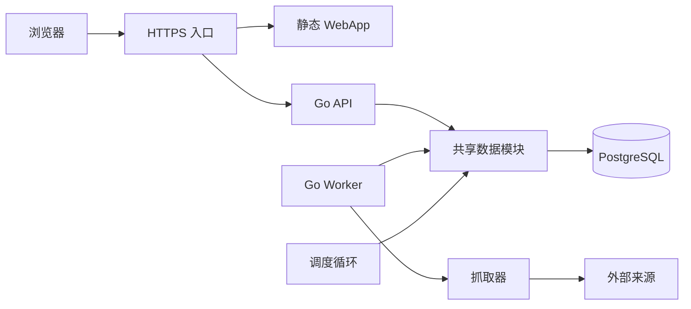
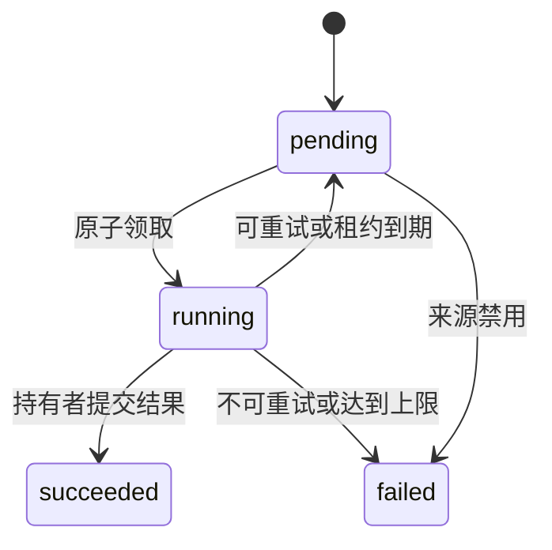

# avxxx 信息平台技术设计

版本：0.2 审查修订稿  
日期：2026年10月8日  
依据：[需求文档](REQUIREMENTS.md)

本设计将需求转化为模块、数据结构、事务和接口约定，用于后续实现与验收。标为“现状”的内容描述已有代码，其余为目标设计。网站、业务字段、规模和部署位置尚未确定，相关扩展点保留配置空间。

## 1 架构与技术栈

采用模块化单仓库，API 和爬虫为独立 Go 进程，React 前端通过 HTTP 调用 API，PostgreSQL 同时保存内容和任务队列。数据模块是进程内共享代码包，不额外部署成服务。首版无需引入 Redis 或独立消息队列。

| 层次 | 技术 | 用途 |
|---|---|---|
| 服务端 | Go、net/http | API、Worker、调度 |
| 数据访问 | pgx/v5、PostgreSQL | 连接池、事务、任务领取 |
| 前端 | React、TypeScript、Vite | 用户页面和管理页面 |
| 数据迁移 | 目标采用 goose | 版本化 SQL、并发迁移锁 |
| 本地环境 | Docker Compose、Makefile | 数据库和开发命令 |
| 生产入口 | HTTPS 反向代理、静态资源服务 | 同域提供 WebApp 与 /api |

现状：Go 1.26.4、React 19.2、TypeScript 5.9、Vite 7，开发数据库镜像为 PostgreSQL 17。目标版本迁移工具尚未接入，目前每次启动执行加锁的幂等初始化 SQL。



调度循环可先放在 Worker 中；多实例通过数据库锁协调。网络请求和解析不得在数据库事务持锁期间执行。

## 2 目录和依赖边界

| 路径 | 目标职责 | 状态 |
|---|---|---|
| cmd/api | 配置、服务组装、优雅关闭 | 已有，待拆分 |
| cmd/scraper | Worker 和调度循环入口 | 已有 Worker |
| internal/config | 配置解析与启动校验 | 待开发 |
| internal/api | 路由、校验、中间件、响应映射 | 待从入口拆出 |
| internal/model | 领域对象及状态定义 | 已有基础对象 |
| internal/store | 唯一 SQL 访问入口、事务 | 已有基础实现 |
| internal/scraper | 执行引擎、抓取器、错误分类 | 已有 RSS 抓取与解析 |
| internal/scraper/source | 适配器注册及解析 | 待拆分 |
| internal/sanitize | 文本和富文本处理 | 待开发 |
| internal/auth | 登录、会话、权限 | 待开发 |
| internal/scheduler | 到期来源调度 | 待开发 |
| migrations | 内嵌 SQL 与迁移入口 | 已有初始化 SQL |
| web/src | 路由、页面、组件、API 客户端 | 已有单文件界面，待拆分 |
| deploy | 部署配置、备份与恢复说明 | 待开发 |

model 不依赖 HTTP 或数据库。store 依赖 model；API、调度和爬虫通过 store 的业务方法协作。适配器只处理输入文档，不直接发请求或写数据库。目标隐藏当前嵌入的公开 pgxpool，防止业务模块绕过 store 执行 SQL。

## 3 数据库设计

所有时间使用 timestamptz，服务内部使用 UTC，界面按用户时区显示。主键使用 bigint；API 将 ID 序列化为十进制字符串，避免 JavaScript 数字精度问题。当前接口仍返回数字 ID，迁移时前后端同步调整。

### 3.1 来源 sources

| 字段 | 类型 | 说明 |
|---|---|---|
| id | bigint | 主键 |
| name、url | text | 名称及入口，url 唯一 |
| adapter | text | rss、atom 或站点适配器标识 |
| enabled | boolean | 是否允许新增及领取任务 |
| config | jsonb | 经适配器 schema 校验的非敏感配置 |
| interval_seconds | integer nullable | 空值表示仅手动采集 |
| next_run_at | timestamptz nullable | 下次调度时间 |
| last_success_at | timestamptz nullable | 最近成功采集时间 |
| etag、last_modified | text nullable | 条件请求缓存标识 |
| publish_policy | text | review 或 automatic，默认 review |
| created_at、updated_at | timestamptz | 配置时间 |

来源增加 version bigint，用于配置编辑的乐观锁。任务领取时保存 adapter、入口 URL、解析配置和配置版本快照，防止执行中编辑来源改变本次采集规则；enabled 在领取与重试时按当前来源行判断，已领取任务遵守第 4.4 节的禁用策略；publish_policy 在提交时按当前来源行判断。配置版本变化时旧任务可以保存快照对应的内容，但不得把旧响应 ETag 或 Last-Modified 写入新配置。URL 或适配器修改时清除条件请求标识，必要时重新建立去重映射。interval_seconds 必须为正且符合来源请求限制。定时查询建立 enabled=true 的 next_run_at 部分索引。

### 3.2 内容 items

保留 id、source_id、title、url、summary，增加 dedupe_key、source_item_id、body_text、可选 body_html、published_at、first_seen_at、last_seen_at、content_updated_at、content_hash、status、deleted_at、version。status 为 draft、published、archived；软删除另外由 deleted_at 表示。

去重键由适配器输出：有稳定来源 ID 时使用带类型前缀的来源 ID，否则使用规范化 URL；建立 UNIQUE(source_id,dedupe_key)。跨来源内容保留各自记录，后续需要时另建聚合映射。当前全局 URL 唯一约束须迁移为来源内去重。先按现存 URL 生成带类型前缀的键；后续获得稳定来源 ID 时，在来源内匹配规范化 URL 并事务更新键，出现多个候选则记录冲突，不能静默合并或插入重复条目。旧约束已丢失的跨来源记录无法从数据库推断，需重新采集补齐。

URL 规范化仅统一协议及主机大小写和默认端口；片段仅在适配器确认不用于条目标识时移除。站点跟踪参数由适配器白名单规则移除，不得全局删除未知查询参数。

content_hash 基于规范化的采集字段计算；相同内容只更新 last_seen_at，避免重复采集改变列表排序。人工字段保存在 item_overrides 中，以 item_id 为主键，字段白名单限定 title、summary、body_text 等。展示值优先采用 override；清除 override 后恢复使用采集值。Worker 不修改 override。NULL 表示无覆盖，空字符串表示明确覆盖为空；清除使用显式字段列表。正文文本和 HTML 必须成对生成并使用同一清洗策略，不能出现覆盖文本后仍展示旧 HTML。人工编辑与采集变更均递增 items.version；content_updated_at 仅在有效展示内容变化时更新，采集 hash 不包含 override。

公开查询统一包含 status='published' AND deleted_at IS NULL。建立公开内容的 (content_updated_at DESC,id DESC) 部分索引，以及来源过滤对应索引。标题子串搜索后续使用 pg_trgm GIN 索引；上线前评估实际语言、数据量及执行计划。

### 3.3 内容发布规则

新增条目按当前 publish_policy 进入 draft 或 published。已有 draft 不因采集自动发布；archived 或软删除内容不得被 Worker 重新发布。已发布条目变化时，automatic 策略更新内容并保持发布；review 策略将其转为 draft，完成审核后重新发布。首版接受重新审核期间暂时不可见，若需保留旧发布版本，应另建内容修订表。发布和下架操作递增 version 并写入审计；last_seen_at 不参与公开列表排序。

### 3.4 任务 jobs

增加 available_at、attempt、max_attempts、worker_id、lease_until、heartbeat_at、execution_version、error_code、result_counts 和来源配置快照。attempt 初值为 0，execution_version 初值为 0；available_at 默认数据库当前时间。max_attempts 必须大于零，running 状态必须具有持有者和租约，终止状态必须具有 finished_at。保留 created_at、started_at、finished_at、error 和四种状态。

```sql
CREATE UNIQUE INDEX jobs_active_source
ON jobs(source_id)
WHERE status IN ('pending', 'running');
CREATE INDEX jobs_pending_due
ON jobs(available_at, id)
WHERE status = 'pending';
CREATE INDEX jobs_expired_lease
ON jobs(lease_until)
WHERE status = 'running';
```

result_counts 记录新增、变化、未变化及丢弃数量。每次执行记录到 job_attempts，保存执行版本、开始结束时间和脱敏错误，避免重试覆盖历史，建立 UNIQUE(job_id,execution_version)。管理员重试创建新任务并记录 retry_of_job_id，仅允许失败任务重试；新任务仍受来源启用和活跃唯一约束限制。来源被引用时不得硬删除。

### 3.5 辅助表

| 表 | 约束和用途 |
|---|---|
| categories、tags、item_tags | 规范化名称唯一，关联组合唯一 |
| users | 登录标识唯一、密码摘要、角色、账号状态 |
| sessions | 令牌摘要、用户、到期时间、撤销时间 |
| favorites | UNIQUE(user_id,item_id)，用户隔离 |
| subscriptions | 用户和来源或分类组合唯一 |
| audit_events | 操作者、动作、对象、脱敏前后差异及时间 |

分类结构待业务确认。用户、收藏、订阅属于后续阶段，不阻塞采集闭环。

## 4 任务调度与执行一致性

### 4.1 创建与调度

手动创建任务在短事务中锁定来源行，检查存在和 enabled，再插入 pending 任务。活跃任务冲突返回 409，不存在返回 404，禁用返回 409。当前 Enqueue 使用 ON CONFLICT DO NOTHING，可能对不存在、禁用或重复任务都返回成功，必须修正。

调度器批量选取到期来源，使用 FOR UPDATE SKIP LOCKED 锁定来源行。任务插入和 next_run_at 更新在同一事务完成。已有活跃任务则推迟到下一调度检查，不补发所有错过的周期。interval 变更时重新计算 next_run_at；多调度器共享相同约束。

### 4.2 领取和租约

目标默认值为每 Worker 一个并发任务、领取轮询 1 秒、租约 90 秒、心跳 20 秒、单次请求超时 30 秒；均可配置，任务总预算需覆盖适配器请求数量。

领取先无锁查出少量候选来源 ID，再在短事务中用 FOR UPDATE SKIP LOCKED 锁来源行，随后用相同方式锁定该来源到期的 pending 任务，并重新检查 enabled、状态和 available_at。跳过已变化候选，更新 running、worker_id、lease_until、attempt=attempt+1 和 execution_version=execution_version+1，创建执行记录后提交。禁止先锁任务再锁来源。所有需要两类锁的事务固定按来源行、任务行顺序；批量来源按 ID 排序。心跳只锁任务且不得随后申请来源锁。候选扫描须有上限并监控饥饿问题。



租约和调度时间均以数据库时钟为准。锁等待结束后使用数据库实际当前时间检查到期，不使用事务开始时刻判断租约；各事务设置锁等待及语句超时。心跳更新必须匹配任务 ID、worker_id、execution_version、running 状态及未过期租约。续约失败或影响行数为零立即取消执行。回收器先查候选，再按来源、任务顺序加锁复查租约；原执行记录标记 lease_expired。来源仍启用且 attempt 小于 max_attempts 时置回 pending 并设置退避时间，否则置 failed；清空持有者和租约。每次失败转移也必须验证执行版本，不能由旧 Worker 改写新执行的状态。

### 4.3 结果提交和失败处理

完成事务先按锁顺序锁定来源和任务，验证持有者、执行版本、running 状态及未过期租约。验证失败不得写任何内容。验证成功后写入条目、更新来源采集信息、完成 job_attempts，并将任务置 succeeded，全部一起提交。提交事务开始后暂停该任务心跳；锁定任务并验证有效租约后，以行锁保护提交与回收互斥。事务设置小于租约窗口的总预算，超时回滚；验证时已过期则拒绝，即使尚未被回收也不能提交。

数据库写入失败时回滚，保留运行状态并在租约有效期内有限次重试提交；持续失败依靠租约回收。数据库提交成功但 Worker 未收到结果时，不重复修改已结束任务，重读状态确认结果。该设计保证至少一次抓取和幂等入库，不承诺外部网络请求只执行一次。

完整任务还需限制总请求数、总响应字节数和总运行时间，避免每次请求有限但任务无限运行。首版任务总超时默认 5 分钟，可按来源调整并设置全局上限。

初始提交条目上限建议 1000 条，超限任务明确失败或转为分批任务，不静默截断。大规模站点后续采用分阶段暂存与发布，不在一个事务中写入无限内容。

### 4.4 禁用来源

禁用操作锁定来源行，设置 enabled=false，并将该来源 pending 任务置 failed，error_code=source_disabled。running 任务允许完成采集和入库，但禁用后禁止新领取及调度；禁用不等于下架已有内容。预览任务采用同样的 pending 终止、running 完成策略。事务与领取采用同样锁顺序以消除竞争。需要立即停止时另行设计取消状态与取消校验。

## 5 抓取器与适配器

目标接口示意，尚未实现：

```go
type Adapter interface {
    Name() string
    Parse(ctx context.Context, doc Document) (ParseResult, error)
}
type Fetcher interface {
    Fetch(ctx context.Context, req FetchRequest) (Document, error)
}
```

Document 包含最终 URL、响应头、状态和受限字节内容；ParseResult 包含统一条目和必要的后续采集引用。引擎管理分页和预算，适配器不得绕过抓取器访问网络。RSS/Atom 提取稳定 ID、链接、标题、摘要和来源发布时间。

当前 RSS 抓取限制 5 MiB、30 秒，解析支持相对链接并过滤非 HTTP(S) 条目链接；未实现站点适配器注册、条件请求和自动重试。RSS/Atom 空结果应区分合法空来源与非空输入全部解析失败，后者报告解析错误。

### 5.1 网络与重试

- 复用 HTTP Client 和 Transport，设置连接、TLS、响应头及总超时。
- DNS 解析、每次连接和每次重定向均校验目标，禁止回环、私网、链路本地和云元数据等非公开地址；按校验后的 IP 建立连接，TLS 使用原主机名。
- 解压后的数据同样受大小限制；重定向次数上限设为 5。
- 网络超时、429、502、503、504 可重试；认证错误、规则失效和普通 4xx 默认不可重试。
- 统一使用任务级重试，每次执行对同一请求默认不做额外自动重试，避免请求重试和任务重试相乘。任务默认最多 3 次执行，指数退避加随机抖动，基础间隔 5 秒、上限 5 分钟；解析 Retry-After 的秒数和 HTTP 日期，将等待时间与退避值取较大者，通过 available_at 表达，不占用 Worker 睡眠。多页任务失败时不提交部分结果，重试重新执行本次采集。
- 首版单来源并发为 1；跨 Worker 的主机级限速使用 host_request_slots(host_key PRIMARY KEY,next_allowed_at) 协调：短事务锁定记录，计算预约时间并更新下一可用时间，提交后再等待和请求。重定向目标同样预约；预约事务与来源、任务事务分开。该机制限制开始频率，不承诺主机级并发数，如站点要求并发上限需另加带租约的请求许可。
- 条件请求仅用于同一来源入口和配置版本的单文档 Feed；验证标识与成功保存的内容在同一事务更新。无已有成功快照时不得把 304 当成成功，应去掉条件头重取一次。多页来源需逐 URL 管理标识，首版默认不启用。304 表示采集内容未变化，但人工编辑及发布状态仍独立处理。

如接入共享出口服务，配置明确的服务地址与来源路由，不从 books 复制部署地址或密钥。HTTP 代理或出口服务如果自行解析域名，应用本地的已校验 IP 不能保证实际连接目标安全；仅接入明确提供等价 DNS、地址及重定向限制的出口服务，否则禁用代理抓取。默认拒绝从环境变量自动继承未知代理。

### 5.2 内容处理

按解析、字段校验、规范化、内容清洗、去重键与 hash 计算顺序处理。摘要默认文本；富文本清洗在入库前完成，前端只接收已清洗字段。必需字段缺失记录丢弃原因；任务结果返回计数，防止解析缺陷被误判成功。

试采集走相同抓取和处理流程，返回有限数量预览及去重结果，不写 items 或正式采集状态。通过有预算的 Worker 预览任务执行，避免长时间占用 API 请求线程。

## 6 API 设计

API 层执行鉴权、输入校验、请求 ID 和错误映射，store 返回类型化领域错误。请求需设置体积限制和数据库上下文超时，不向客户端输出 SQL 错误。

### 6.1 目标接口

| 方法和路径 | 功能 | 权限 |
|---|---|---|
| GET /api/items | 分页搜索、来源及标签筛选 | 公开 |
| GET /api/items/{id} | 已发布内容详情 | 公开 |
| GET、POST /api/admin/sources | 来源查询和创建 | 管理员 |
| PATCH /api/admin/sources/{id} | 配置编辑、启用禁用 | 管理员 |
| POST /api/admin/sources/{id}/jobs | 返回新任务 ID | 管理员 |
| POST /api/admin/sources/{id}/previews | 创建试采集任务 | 管理员 |
| GET /api/admin/previews/{id} | 获取脱敏预览结果 | 管理员 |
| GET /api/admin/jobs、GET /api/admin/jobs/{id} | 查询任务及执行记录 | 管理员 |
| POST /api/admin/jobs/{id}/retry | 为终止任务创建新任务 | 管理员 |
| GET /api/admin/items、GET /api/admin/items/{id}、PATCH /api/admin/items/{id} | 内容及 override 管理 | 管理员 |
| POST /api/admin/items/{id}/publish、POST /api/admin/items/{id}/archive | 发布、下架 | 管理员 |
| GET /api/health | 就绪检查，包含数据库连接 | 运维 |
| GET /api/live | 进程存活检查，不依赖数据库 | 运维 |

预览任务使用独立 preview_jobs 表和过期清理，不写正式内容、正式任务结果或来源条件请求标识。其领取和租约复用执行机制，但提交路径独立；正式任务与预览任务共同遵守每来源并发上限：两类领取事务均先锁来源，再检查两个任务表是否存在 running 任务，有则跳过；没有时才领取本表任务。两个表的 running 状态变更都遵守来源、任务锁顺序，心跳只更新本表任务。该来源行锁作为跨表互斥入口，不能仅依靠 jobs 的唯一索引限制预览并发。预览结果包含条目样例、计数和去重判断，默认保留 24 小时，单来源只允许一个活跃预览。

### 6.2 分页和响应

列表参数包括 q、source_id、tag_id、limit、cursor。limit 默认 20、最大 100；首版按 content_updated_at DESC,id DESC 排序。游标编码版本、末条时间与 ID，并绑定筛选条件；非法游标返回 400。排序变更必须定义相应索引和游标结构。更新中的列表可能跨页移动，首版不保证快照浏览。

```json
{"items":[{"id":"123","title":"示例","source_id":"8"}],"next_cursor":"..."}
```

目标错误格式：

```json
{"error":{"code":"source_disabled","message":"来源已禁用","request_id":"..."}}
```

创建来源返回 201，异步任务返回 202；重复来源返回 409。管理编辑提交 version，版本冲突返回 409；来源、内容以及发布下架均执行相同版本检查。PATCH 字段采用白名单，禁止修改 source_id、去重键及采集时间；软删除通过 DELETE /api/admin/items/{id} 执行并写入审计。来源只禁用，不提供硬删除接口。健康检查数据库不可用返回 503，公开未发布或软删除条目统一返回 404。所有操作仅返回实际结果；当前来源 POST 的同 URL 更新行为改为明确创建和 PATCH 更新。

当前公开列表为裸数组且最多 100 条，无分页、发布状态、详情；管理错误混用文本和 JSON。接口迁移需与前端一起上线。

## 7 前端设计

将现有 main.tsx 拆为入口、路由、api 客户端、公共组件和页面。页面划分为信息列表、详情、来源管理、任务管理、内容管理和登录；个人收藏与设置在后续增加。

API 客户端集中处理 ID 字符串、分页、401、错误结构和请求取消。筛选条件写入 URL，搜索请求在提交或适当防抖后发起；过期请求不得覆盖较新结果。任务详情只在可见且处于活跃状态时轮询，结束后停止。

页面分别表示 loading、empty、error、success 状态；用户查询与管理员查询使用不同缓存键。管理操作成功后刷新对应数据。摘要使用 React 文本渲染，清洗后的富文本使用独立受控组件。

开发阶段可保留内存 ADMIN_TOKEN；生产版使用会话 cookie，禁止将长期管理员密钥写入浏览器持久存储。

## 8 鉴权与审计

目标采用服务端会话，随机令牌仅在 HttpOnly、Secure、SameSite cookie 中传输，数据库只保存令牌摘要。密码通过维护的密码哈希库处理；用户状态和角色在授权时校验。

修改请求校验 Origin 并使用 CSRF 令牌；同域部署默认不开放跨域访问。登录及管理操作设置请求速率限制。内容编辑、发布下架、来源配置变更与审计记录在同一事务提交。审计不包含令牌、密码或敏感来源配置。

公开 DTO 不输出采集配置、原始错误及管理员字段。公开接口和管理接口使用不同查询方法，避免遗漏发布过滤条件。

## 9 配置与部署

| 配置项 | 当前或目标值 | 说明 |
|---|---|---|
| DATABASE_URL | 当前已有 | 必填，启动时校验和连接 |
| API_ADDR | 当前默认 127.0.0.1:8080 | 容器中显式设监听地址 |
| ADMIN_TOKEN | 当前已有 | 仅开发阶段使用 |
| WORKER_CONCURRENCY | 目标默认 1 | 按站点和数据库容量调整 |
| JOB_LEASE_SECONDS | 目标默认 90 | 必须大于心跳间隔 |
| JOB_TIMEOUT_SECONDS | 目标默认 300 | 总抓取和解析预算，提交另设短事务超时 |
| JOB_HEARTBEAT_SECONDS | 目标默认 20 | 启动时校验合理范围 |
| FETCH_TIMEOUT_SECONDS | 目标默认 30 | 单请求超时 |
| FETCH_MAX_BYTES | 目标默认 5242880 | 解压后响应上限 |
| SCHEDULER_ENABLED | 目标可配置 | 手动阶段可关闭 |

本地通过 make db-up、make api、make scraper、make web 启动，详见项目 README。当前 Compose 只定义数据库，前后端由宿主机启动，不是完整生产部署。

生产目标拆为静态 Web、API、Worker 和数据库；反向代理统一提供 HTTPS。数据库不公开端口，API 与 Worker 使用受限业务角色；迁移使用单独的 DDL 凭据。开发阶段可启动时迁移，生产在部署步骤中串行运行迁移，服务启动仅检查支持的 schema 版本范围。首次接入 goose 时，为已有库建立经结构校验的基线版本，不把全部历史 DDL 重新执行。去重约束切换采用短维护窗口：停止 Worker 和管理写入，回填检查、切换 SQL 与约束，发布新版服务后恢复；不能让旧 ON CONFLICT(url) 写入逻辑与删除 URL 唯一约束同时运行。

服务滚动升级先部署向后兼容的新增字段，再升级读写代码，最后清理旧字段。长时间回填分批执行，避免把 DDL 锁与大量回填放在同一事务。退出时停止领取，取消或限时完成当前任务，API 使用 Shutdown，所有路径关闭连接池。

## 10 日志、监控和备份

日志采用结构化字段 request_id、source_id、job_id、execution_version、duration、error_code。采集成功日志记录新增、变化和跳过计数，日志不包含凭据或完整私密内容。

监控覆盖队列长度和最老等待时间、成功失败次数、来源最后成功时间、请求耗时和状态、租约回收次数、数据库连接池等待。告警阈值按来源采集周期和业务规模配置，避免把合法空来源当成故障。

上线前确定备份周期、保留时间、RPO 和 RTO。基础方案为数据库定期备份到独立存储并加密；若恢复目标要求更短窗口，再加入 WAL 归档。备份成功以独立环境恢复、行数与关键内容校验为依据。任务历史与审计按保留策略清理，保留策略尚待确认。

## 11 测试与验证

| 层次 | 关键验证 |
|---|---|
| 解析单元测试 | RSS/Atom、相对 URL、稳定 ID、空来源、损坏 XML、危险链接 |
| 抓取测试 | 超时、大小上限、重定向、DNS 地址校验、429 和 Retry-After、304 |
| PostgreSQL 集成测试 | 唯一约束、锁顺序与死锁回归、并发领取、租约回收、旧 Worker 提交被拒、事务回滚、正式与预览互斥 |
| API 测试 | 鉴权、404/409、错误结构、发布过滤、游标分页、编辑冲突、来源禁用和领取竞争 |
| 前端测试 | 筛选与分页、状态展示、请求竞争、401、移动布局及键盘操作 |
| 端到端测试 | 固定本地来源 → 管理创建任务 → Worker → 内容发布 → 用户查询 |
| 运维验证 | 并发迁移、滚动兼容、进程退出、备份恢复 |

集成测试的本地来源需在测试模式显式放行指定回环地址，生产配置禁止该例外。数据库测试使用独立临时数据库，不使用现有 books 或其它项目数据。

当前已有 RSS/Atom 解析测试和基础构建检查；租约、API、数据库端到端及生产运维验证仍待实施。性能测试根据来源数量和内容规模确定负载与目标，不使用未确认指标作为上线承诺。

## 12 实施顺序与需求对应

| 顺序 | 技术交付 | 对应需求 |
|---|---|---|
| 1 | 拆分配置、API 和 store 边界，统一错误 | 模块边界、接口约束 |
| 2 | 版本化迁移、内容状态、去重与 override | 数据管理、人工编辑保护 |
| 3 | 执行版本、心跳、租约回收与事务完成，含 PostgreSQL 集成测试 | 任务可靠性、并发一致性 |
| 4 | 来源禁用、周期调度、抓取器、网络访问限制与适配器 | 来源管理、定时采集 |
| 5 | 列表分页、详情、审核和管理页面 | 用户展示、数据管理 |
| 6 | 生产会话、审计和安全回归 | 安全与角色权限 |
| 7 | 部署、监控、备份恢复和端到端验收 | 稳定运营、数据保护 |
| 8 | 目标站点及用户收藏、通知 | 业务适配与用户增强 |

具体网站适配可在目标明确后与上述基础能力交错推进。审核策略默认保守使用 review；确认无需审核后再启用 automatic。以上新增目标尚未实现；尤其当前 Worker 无租约和执行版本，现有所有内容直接公开，现有网络客户端未限制私网目标。实现相应目标后再按需求验收，不能把本设计视为现状保证。正文媒体存储、业务分类、规模指标及共享出口地址必须在实现对应功能前确认。
